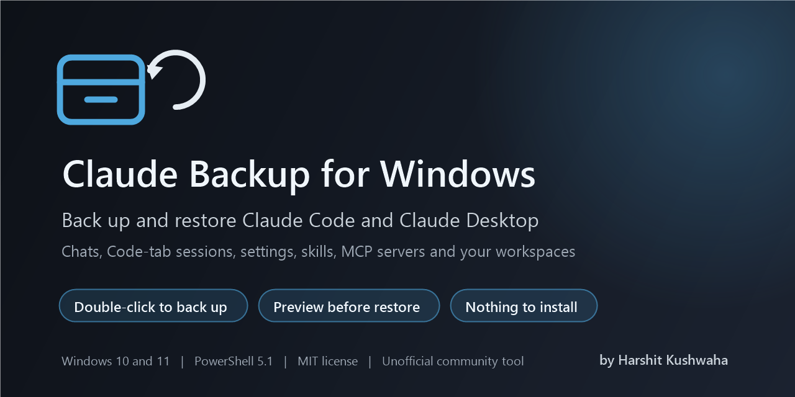

# Claude Code and Claude Desktop backup for Windows

<p align="center">
  
</p>

<p align="center">
  <a href="../../releases/latest"></a>
  
  
  <a href="LICENSE"></a>
  <a href="https://www.linkedin.com/in/hrshtk/"></a>
</p>

Back up Claude Code and Claude Desktop on Windows, then restore them on the same PC or a new one. A backup holds your chat history, Code-tab sessions, settings, skills, plugins, memory, local MCP servers and the project folders you work in with Claude.

Claude keeps this data in several folders across your user profile, and Claude Desktop moved its own folder when it updated to version 3. Copying `.claude` by hand leaves Claude Desktop's settings and session list behind. This tool finds every location, lets you pick your workspaces from a list, and writes a backup folder that has its own restore program inside.

- Double-click `Backup-Claude.bat` to back up, and `Restore-Claude.bat` to restore.
- Your workspaces are found from your chat history, so you tick them in a list instead of typing paths.
- Every restore starts with a preview. Nothing is deleted, and each file that gets replaced is copied aside first.
- It runs on Windows PowerShell 5.1, which comes with Windows 10 and 11.

> [!WARNING]
> A backup contains your MCP server passwords and API keys in plain text. Keep it private. See [Security](#security).

> [!NOTE]
> This is an unofficial community tool. Anthropic does not make or support it.

## Contents

- [Quick start](#quick-start)
- [What a backup folder contains](#what-a-backup-folder-contains)
- [What gets backed up](#what-gets-backed-up)
- [Where Claude stores its data on Windows](#where-claude-stores-its-data-on-windows)
- [How workspaces are found](#how-workspaces-are-found)
- [What is left out](#what-is-left-out)
- [Restore on a new PC](#restore-on-a-new-pc)
- [Command-line options](#command-line-options)
- [Security](#security)
- [FAQ](#faq)
- [Requirements and limitations](#requirements-and-limitations)
- [Troubleshooting](#troubleshooting)
- [Running the tests](#running-the-tests)
- [Author](#author)

## Quick start

1. [Download the latest release](../../releases/latest) and extract it, or clone this repository.
2. Double-click `Backup-Claude.bat`.
3. Tick the workspaces you want, press Enter, and confirm.
4. When it finishes, your backup folder opens: `Downloads\Claude-Backup_<date>_<time>`.

To restore, copy that folder to the PC and double-click `Restore-Claude.bat` inside it. It shows a preview first and restores only after you type `YES`.

If Windows shows "Windows protected your PC", choose More info, then Run anyway. You can also right-click the file, open Properties and tick Unblock.

## What a backup folder contains

```
Downloads\Claude-Backup_2026-10-22_131805\
    claude-backup_2026-10-22_131805.zip   the backup
    Restore-Claude.bat                    double-click to restore (preview first, then asks)
    Restore-Claude.ps1                    the restore program
    README.txt                            what is in this backup, where it goes back, how to restore
```

The zip carries its own copy of the README and the restore program, so the zip alone is enough to restore from.

## What gets backed up

Always included:

| Item | Location | What it holds |
| --- | --- | --- |
| Claude Code | `%USERPROFILE%\.claude`, or `CLAUDE_CONFIG_DIR` if set | Settings, chat transcripts, skills, plugins, memory, agents, file checkpoints |
| Claude Code settings file | `%USERPROFILE%\.claude.json` and its old copies | Account details, per-project settings, MCP servers |
| Claude Desktop | The folder Claude Desktop uses on this PC ([see below](#where-claude-stores-its-data-on-windows)) | Settings, MCP setup in `claude_desktop_config.json`, the Code-tab session list, plugins and skills |
| Claude Desktop logs | `%LOCALAPPDATA%\Claude` | Logs |
| Claude service log | `%ProgramData%\Claude` | A log, when present |

You choose:

| Item | How it is found |
| --- | --- |
| Workspaces, the folders you open Claude in | Your chat history, Claude Desktop's session list and Claude Code's project list |
| Local MCP server folders | The script paths in your MCP server settings |
| Any other folder | Added by you at the menu with `+`, or with `-Workspace` |

## Where Claude stores its data on Windows

| Data | Location |
| --- | --- |
| Claude Code folder | `%USERPROFILE%\.claude` (or the folder set in `CLAUDE_CONFIG_DIR`) |
| Claude Code chat transcripts | `%USERPROFILE%\.claude\projects\<project>\<session>.jsonl` |
| Claude Code account, project settings and MCP servers | `%USERPROFILE%\.claude.json` |
| Claude Desktop, Store app version 3 and later | `%LOCALAPPDATA%\Claude-Data\claude_pzs8sxrjxfjjc` |
| Claude Desktop, Store app version 2 | `%LOCALAPPDATA%\Packages\Claude_pzs8sxrjxfjjc\LocalCache\Roaming\Claude` |
| Claude Desktop, classic installer | `%APPDATA%\Claude` |
| Claude Desktop MCP servers | `claude_desktop_config.json` in the Claude Desktop folder |
| Claude Desktop Code-tab sessions | `claude-code-sessions` in the Claude Desktop folder |
| Claude Desktop logs | `%LOCALAPPDATA%\Claude` |

Version 2 of the Store app writes to `%APPDATA%\Claude`, and Windows redirects those writes into the package folder. A terminal opened inside Claude Desktop sees the short path, while Explorer and other programs see only the package folder. The backup reads the real location, so it works however you start it.

## How workspaces are found

A workspace is a folder you opened Claude in. The backup collects them from:

- the chat transcripts in `.claude\projects`, each of which records the folder it ran in
- Claude Desktop's Code-tab session cards
- the project list in `.claude.json`

Folders that no longer exist are skipped, and so are temporary folders and Claude's own folders. A folder inside another workspace counts as part of it. Very broad folders, such as a whole drive or your user folder, appear in the list unticked.

Local MCP server folders come from the `command`, `args` and `env` paths of the MCP servers in Claude Desktop's and Claude Code's settings. For each server, the backup takes the nearest folder with a `package.json`, `pyproject.toml`, `.git` or a similar project file. Servers kept side by side, such as `...\mcp-servers\github` and `...\mcp-servers\notion`, are saved as their shared parent folder, which also picks up shared files like a key file. Servers started with `npx` are not copied, because they download again on first start.

If no workspaces turn up, the backup asks you to type the folders in.

```
Workspaces and folders you can include:
   #  Pick  Type        Folder                    Found from     Last used         Size
   1  [x]   Workspace   D:\Code\shop-site         41 chats       2026-10-22      88.0 MB
   2  [x]   Workspace   C:\Notes                  6 chats        2026-10-19       2.1 MB
   3  [ ]   Workspace   C:\Users\you              2 chats        2026-09-30   over 40 GB  (very broad)
   4  [x]   MCP servers C:\Users\you\mcp-servers  github, notion                 120.4 MB

  Numbers switch items on/off (e.g. 2   1,3   2-4).  A = all   N = none   + = add a folder
  Press Enter to continue with the ticked items, or Q to quit
```

## What is left out

The backup skips files that Claude rebuilds on its own and files that would not work on another PC. Each backup's `README.txt` lists them with file counts.

| Left out | Reason |
| --- | --- |
| Claude Desktop browser caches (`Cache`, `Code Cache`, `GPUCache`, `ShaderCache` and similar) | Rebuilt automatically. They often take several hundred MB |
| Claude Desktop `Network` folders, which hold cookies | Encrypted for this PC only. You sign in again instead |
| Claude Desktop `Local State` | Holds an encryption key that only works for this Windows account |
| `LOCK` and `lockfile` files | In-use markers, recreated automatically |
| `.claude\cache`, `sessions`, `shell-snapshots`, `session-env` | Caches, a list of running processes and per-session temp data |
| `__pycache__` folders | Python cache |
| Earlier backups: `claude-backup_*.zip`, `pre-restore_*` folders and backup folders made by this tool | Keeps each backup from swallowing the previous ones |
| The Claude programs | Reinstall them. Store apps cannot be copied back |

Links and junctions are not followed.

## Restore on a new PC

1. If you use Claude Desktop, install it from [claude.ai/download](https://claude.ai/download), open it once, then quit it from the system tray. Install [Node.js](https://nodejs.org) if your local MCP servers need it.
2. Close any terminal running `claude`.
3. Double-click `Restore-Claude.bat` in the backup folder and read the preview.
4. Type `YES` to restore.
5. Open Claude Desktop and sign in with the same Claude account as before.

The preview counts the files in each backed-up location: new, to be replaced, newer on disk than the backup, identical (left alone), or held back for now.

| Situation | What the restore does |
| --- | --- |
| A file matches the backup | Leaves it alone |
| A file differs from the backup | Copies it to `pre-restore_<date>` next to the zip, then replaces it. `INDEX.csv` in that folder lists where each copy came from |
| Files on the PC that are not in the backup | Leaves them alone. The restore never deletes anything |
| The Windows user name is different | Puts files from the old user folder into the new one and updates user-folder paths inside Claude's own config files. Files in your workspaces are not edited |
| Claude Desktop is a different version or install type | Puts Claude Desktop's data in the folder that version uses |
| The Claude Desktop sign-in came from another PC or account | Removes it and keeps any sign-in already on this PC, so Claude asks you to sign in. On the same PC and account the sign-in keeps working |
| Claude Desktop is not installed, or was never opened | Holds its data back and prints the command to finish later |
| `%ProgramData%\Claude` without Administrator rights | Holds it back and prints the command to run as Administrator |
| A workspace was on a drive this PC doesn't have | Holds it back. Connect the drive, or copy the files out of the zip by hand |
| Claude is running | Stops before writing anything |
| Paths longer than 260 characters | Restores them. Some Claude Desktop plugin files are that deep |

### Claude Desktop sessions

A Code-tab session has two parts: a session card in Claude Desktop's folder with its title, working folder and settings, and the conversation itself in `.claude\projects`. The backup includes both. Your sessions are listed again after a restore when you sign in with the same Claude account and your workspaces are back at the same paths, because each session remembers its folder. Open Claude Desktop once before restoring so the restore knows which folder that Claude Desktop version reads.

## Command-line options

Run these from PowerShell or Command Prompt in the repository folder.

```powershell
# Back up, choosing workspaces from the menu
powershell -ExecutionPolicy Bypass -File .\Backup-Claude.ps1

# Show what would be found, without backing anything up
powershell -ExecutionPolicy Bypass -File .\Backup-Claude.ps1 -ListOnly

# Back up chosen folders with no questions, for example from Task Scheduler
powershell -ExecutionPolicy Bypass -File .\Backup-Claude.ps1 -Workspace 'D:\Code\shop-site', 'C:\Notes' -Yes

# Back up every workspace found, compressed, to another drive
powershell -ExecutionPolicy Bypass -File .\Backup-Claude.ps1 -AllWorkspaces -Compress -OutputRoot 'E:\Backups' -Yes
```

| Backup option | What it does |
| --- | --- |
| `-Workspace <folders>` | Includes these folders instead of showing the menu |
| `-AllWorkspaces` | Includes every workspace found, except very broad ones |
| `-NoWorkspaces` | Backs up Claude's own data and MCP server folders only |
| `-OutputRoot <folder>` | Creates the backup folder here. Default: your Downloads folder |
| `-Compress` | Makes a smaller zip, more slowly. Default: files stored uncompressed |
| `-Yes` | Asks nothing. Without a selection option it uses the recommended selection |
| `-ListOnly` | Shows what was found, then stops |
| `-OpenFolder` | Opens the backup folder when done. `Backup-Claude.bat` uses this |

```powershell
# Preview a restore (writes nothing)
powershell -ExecutionPolicy Bypass -File .\Restore-Claude.ps1 -ZipPath .\claude-backup_2026-10-22_131805.zip

# Restore everything
powershell -ExecutionPolicy Bypass -File .\Restore-Claude.ps1 -ZipPath .\claude-backup_2026-10-22_131805.zip -Apply

# Restore one location
powershell -ExecutionPolicy Bypass -File .\Restore-Claude.ps1 -ZipPath .\claude-backup_2026-10-22_131805.zip -Only 'D:\Code\shop-site' -Apply
```

| Restore option | What it does |
| --- | --- |
| `-ZipPath <zip>` | The backup to restore. Required |
| `-Apply` | Writes files. Without it, the run is a preview |
| `-Only <locations>` | Restores only these locations, as listed in the backup's `README.txt` |
| `-NoSafetyCopy` | Skips the copies of replaced files. Not recommended |
| `-Force` | Restores while Claude is running. Meant for testing |

## Security

- Backups are not encrypted. They hold MCP server logins and keys from `claude_desktop_config.json` and `.claude.json`, your Claude account details, and any key files in your workspaces or MCP server folders. Each backup's `README.txt` names the sensitive files it noticed.
- Keep backups on storage only you can open. To add a password, put the zip inside a 7-Zip archive with AES-256 encryption.
- Never commit a backup to Git, upload it to a shared drive or attach it to an issue. This repository's `.gitignore` blocks backup files.
- Claude Desktop's saved sign-in is encrypted by Windows for your account and can't be used on another PC. The restore removes it there and keeps any sign-in that PC already has.

To report a security problem, see [SECURITY.md](SECURITY.md).

## FAQ

### How do I move Claude Code to a new computer?

Run `Backup-Claude.bat` on the old PC and copy the backup folder to the new one. On the new PC, install Claude Desktop if you use it, open it once and quit it, then run `Restore-Claude.bat`. Chats, settings, skills, plugins and MCP servers go back where they were, adjusted for a different Windows user name if needed.

### Where does Claude Code keep chat history on Windows?

In `%USERPROFILE%\.claude\projects`. Each project has its own folder, and each chat is a `.jsonl` file in it. The full list of locations is in [Where Claude stores its data on Windows](#where-claude-stores-its-data-on-windows).

### Will my Claude Desktop Code-tab sessions come back?

The backup holds both parts of each session: the session card and the conversation. The restore puts the cards in the folder Claude Desktop uses on the new PC. Sign in with the same Claude account and keep your workspaces at the same paths, since each session remembers its folder.

### Does it back up my claude.ai chats?

Chats in Claude Desktop's Chat tab and on claude.ai are saved to your Claude account, so they are there again when you sign in. This tool backs up what is stored on your PC: Claude Code, Code-tab sessions, settings, skills, plugins and MCP servers.

### Are my API keys and MCP passwords in the backup?

Yes. MCP server settings often hold passwords and API keys in plain text, and the backup copies them as they are so your servers work after a restore. Keep the backup private, or put it in an encrypted 7-Zip archive.

### Can I restore under a different Windows user name?

Yes. Files from the old user folder go into the new one, and the restore updates user-folder paths in Claude's own config files, such as the paths to your MCP servers. Your workspace files are left as they are.

### Do I need to install anything?

No. Windows 10 and 11 include Windows PowerShell 5.1, and the backup is an ordinary zip file. On the new PC you only need Node.js or Python if your local MCP servers use them.

### How big is a backup?

About the size of the data inside it, because files are stored uncompressed by default. Claude Desktop's caches are left out, and they are often several hundred MB on their own. Add `-Compress` for a smaller zip.

### Can I schedule automatic backups?

Yes. Run `Backup-Claude.ps1 -Yes` from Task Scheduler with `-AllWorkspaces` or `-Workspace`, and `-OutputRoot` to choose where backups go. Each run makes a new folder and old ones are kept, so clear them out now and then.

### Does it work on macOS or Linux?

No. It is written for Windows and Windows PowerShell 5.1.

## Requirements and limitations

- Windows 10 or 11 with Windows PowerShell 5.1, which is built in.
- Workspaces go back to the same paths they came from, and sessions depend on that.
- Remote (SSH) and cloud sessions live on other machines, so they are not in the backup.
- Files Claude is writing during a backup are copied as they are at that moment. Claude Desktop sometimes deletes a few internal storage files mid-backup, and those are listed as skipped. Quit Claude first for a complete copy.

How the programs work inside, including the backup format, sign-in handling and long paths, is described in [docs/how-it-works.md](docs/how-it-works.md).

## Troubleshooting

| Message or symptom | Fix |
| --- | --- |
| `Skipped : N could not be read` | Claude had those files open or rewrote them during the backup. Quit Claude from the system tray and back up again |
| `Running scripts is disabled on this system` | Use the `.bat` files, or run the commands as shown, with `-ExecutionPolicy Bypass` |
| `Claude is running` | Quit Claude Desktop from the system tray and close any `claude` terminals |
| `Held back: ... has not been opened on this PC yet` | Open Claude Desktop once, quit it, then run the printed command |
| `Held back: ... needs PowerShell opened as Administrator` | Open PowerShell as Administrator and run the printed command |
| `Zip check failed` | Check free disk space and run the backup again |
| Sessions missing after a restore | Sign in with the original Claude account, run any `Not restored yet` command, and check your workspaces are at their original paths |
| An MCP server doesn't start | Install Node.js or Python as needed. Servers started with `npx` need internet the first time |

## Running the tests

```powershell
powershell -ExecutionPolicy Bypass -File .\tests\Run-Tests.ps1
```

The tests build fake backups and restore them inside `%TEMP%\claude-backup-tests`, with the user folders pointed there, so your real files are never touched. Contributions are welcome; see [CONTRIBUTING.md](CONTRIBUTING.md).

## Author

Claude Backup for Windows is written and maintained by Harshit Kushwaha. For questions, ideas or work enquiries, contact Harshit on [LinkedIn](https://www.linkedin.com/in/hrshtk/). Bugs and feature requests go in this repository's issues.

## License

[MIT](LICENSE), copyright 2026 Harshit Kushwaha.
